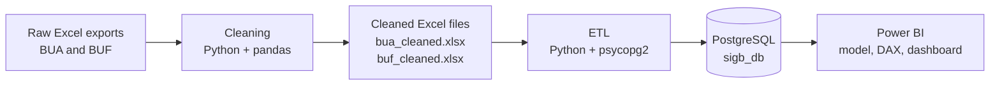
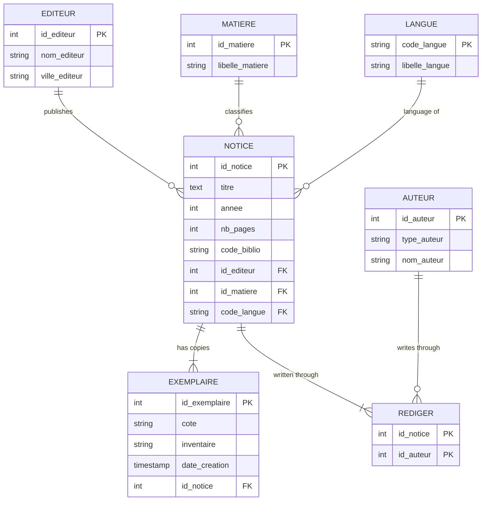
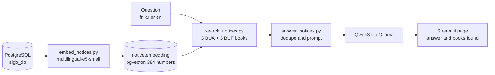

# Library BI RAG assistant

A complete Business Intelligence pipeline for a university library: two raw catalog exports are cleaned with Python, loaded into a normalized PostgreSQL database through an ETL script, and analyzed in an interactive Power BI dashboard.


## Table of contents

- [Overview](#overview)
- [Architecture](#architecture)
- [Tech stack](#tech-stack)
- [Data model](#data-model)
- [The pipeline step by step](#the-pipeline-step-by-step)
- [Results](#results)
- [Dashboard](#dashboard)
- [RAG assistant (extension)](#rag-assistant-extension)
- [Getting started](#getting-started)
- [Project structure](#project-structure)
- [Limitations and future work](#limitations-and-future-work)
- [Team](#team)

## Overview

Libraries store a lot of bibliographic data in their management system (SIGB, *Système Intégré de Gestion de Bibliothèque*): books, authors, publishers, subjects and physical copies. In raw form this data is hard to use for decisions.

**Guiding question:** how can raw bibliographic data become information that helps a library manager make decisions?

**Objectives**

1. Design a relational database for notices, copies, authors, subjects and publishers.
2. Automate the integration and cleaning of the source files.
3. Define KPIs that describe the state of the collection.
4. Build an interactive Power BI dashboard for analysis and decision support.

**Source data:** two Excel exports from the library SIGB.

| File | Collection |
| --- | --- |
| BUA | Arabic collection |
| BUF | French collection |

## Architecture



Each stage has one job: cleaning makes the data trustworthy, the relational database stores it without redundancy and with enforced integrity, and Power BI makes it understandable.

## Tech stack

| Tool | Role in the project |
| --- | --- |
| Draw.io | Conceptual (MCD) and logical (MLD) models |
| Excel | Source files and visual before/after checks |
| Python | Cleaning and ETL scripts |
| pandas | Reading Excel, cleaning columns, merging files |
| re (regular expressions) | Extracting years, cleaning call numbers, detecting Arabic text |
| psycopg2 | PostgreSQL connection, inserts and transactions |
| python-dotenv | Database credentials loaded from a `.env` file |
| PostgreSQL | Normalized relational database (`sigb_db`) |
| pgAdmin | Validation queries on the loaded data |
| Power BI + DAX | Data model, measures and dashboard |
| Visual Studio Code | Development environment |
| Docker | Second PostgreSQL with the pgvector extension (RAG extension) |
| pgvector | Vector column, cosine search and HNSW index (RAG extension) |
| sentence-transformers | Multilingual embeddings with `intfloat/multilingual-e5-small` (RAG extension) |
| Ollama + Qwen3 4B | Local language model that writes the answers (RAG extension) |
| Streamlit | Demo page (RAG extension) |

## Data model

Six entities and one junction table. The key design decision is the separation of **notice** (the work, as an intellectual object) from **exemplaire** (a physical copy): three copies of the same book are one notice and three exemplaires.



**Why this structure**

- **Normalization:** each fact is stored once and referenced by key, which avoids redundancy and inconsistent spellings.
- **Many-to-many authors:** a book can have several authors and an author can write several books, so the link goes through the `REDIGER` table with a composite primary key.
- **Integrity:** foreign keys, `UNIQUE` constraints and a `CHECK` on `code_biblio` are enforced by PostgreSQL.

## The pipeline step by step

### 1. Data cleaning

An automated Python script (pandas and regular expressions) processes each source file:

- Removes rows without a valid inventory number, since it identifies a physical copy.
- Standardizes text fields: trims spaces, removes parasitic characters, unifies separators, strips trailing punctuation.
- Cleans call numbers (*cotes*): removes month-and-year fragments such as `02-janv` and trailing years.
- Extracts clean author names from role annotations, for example `(Auteur) Victor Hugo` becomes `Victor Hugo`.
- Removes records marked as duplicates in the Arabic file (*mkarrar*).
- Keeps publication years between 1000 and 2030.
- Converts the page count to a number and fills missing values with the **median**.
- Fills missing descriptive fields with explicit labels (`Anonyme`, `Inconnu`, `Non spécifiée`).
- Removes notices without a title.
- Adds the collection code (BUA or BUF) and a language tag.
- Runs consistency checks, then exports `bua_cleaned.xlsx` and `buf_cleaned.xlsx`.

### 2. ETL (Extract, Transform, Load)

**Extract**

- Reads both cleaned files with pandas and adds a `source_camp` column (BUA or BUF) to keep each row's origin.
- Concatenates them into one DataFrame.
- Connection settings (database, user, password, host, port) are stored in a `.env` file, never in the code.

**Transform**

- Fills the reference tables first (language, publisher, author, subject), respecting foreign key order.
- Uses `ON CONFLICT` clauses so the script is **idempotent**: running it twice creates no duplicates.
- Deduplicates notices across campuses with an in-memory registry. The key is the normalized title and the publication year: a new key creates a notice, a known key reuses the existing one. Every row still creates its own physical copy.

**Load**

- The whole load runs in a **single transaction**: `commit()` if everything succeeds, `rollback()` on any error, so the database is never left half-loaded.

### 3. Validation

SQL checks run in pgAdmin after the load:

- Row counts per table.
- No notice without a copy.
- Inventory numbers are unique.
- BUA / BUF distribution through `code_biblio`.
- Foreign keys and referential integrity.

### 4. Power BI

- Connects to PostgreSQL and organizes the tables as a star schema: `notice` as the central table, linked to the language, subject and publisher dimensions and to the copies table. Authors connect through the `REDIGER` bridge table.
- DAX measures and one calculated column:

```dax
Total Notices = COUNTROWS('public notice')

Ratio Exemplaires =
DIVIDE(
    COUNT('public exemplaire'[id_exemplaire]),
    [Total Notices],
    0
)

Decennie = FLOOR('public notice'[annee], 10)
```

## Results

| Indicator | Value |
| --- | --- |
| Unique notices | 23,175 |
| Physical copies (exemplaires) | 25,053 |
| Subjects (matières) | 6,111 |
| Split by collection | 61.83% BUA, 38.17% BUF |

More copies than notices confirms that the work-versus-copy logic and the cross-campus deduplication work as intended.

## Dashboard

The Power BI report contains:

- Three KPI cards: total notices, authors, publishers.
- A donut chart of the BUA / BUF split.
- A top 10 of the most represented subjects.
- A top 10 of the most represented authors.
- A line chart of publications per decade.
- A `code_biblio` slicer that cross-filters the whole page.

**Main findings**

- The Arabic collection holds the majority of the catalog.
- Subjects show a strong specialization in Islamic sciences and Arabic language and literature, alongside economics and philosophy.
- Publications are concentrated in the second half of the 20th century, with a few rare older items.

<!-- Add your screenshots here, for example:


-->

## RAG assistant (extension)

An extension designed and built by Fatima Ezzahrae Zammou on top of the BI project: a question in Arabic, French or English is searched in the catalog, and a local language model writes a short answer from the books it finds. Everything runs on one computer, with no paid API.




**How it works**

1. **Embedding (once).** Each of the 23,175 notices becomes one vector of 384 numbers, built from its title, subject and author together, and stored in `notice.embedding`. The model understands Arabic, French and English in one shared space, so a question can match a book that shares none of its words.
2. **Search.** The question is encoded with the same model, and pgvector returns the closest books by cosine distance, with an HNSW index. The search runs once per collection and keeps the top 3 of BUA and the top 3 of BUF, because a single search favors the language of the question.
3. **Answer.** Near-identical records are merged, then the books and the question are sent to Qwen3 4B running in Ollama. The prompt tells the model to use only these records, never to invent a book, author, year or page count, and to answer in the language of the question. If the model is cut off before a usable answer, the plain list of books is shown instead.
4. **Page.** The Streamlit page shows the answer next to the retrieved books and their scores, so every answer can be checked against the database.

**Example:** asked "How many pages does The philosophy of law by Dworkin have?", the assistant retrieves the record (Dworkin, 1977, 172 pages) and answers 172.

**Run it**

```bash
# 1. Second PostgreSQL with pgvector (the original one on port 5432 is untouched)
docker run --name sigb-pg -e POSTGRES_PASSWORD=your_password -e POSTGRES_DB=sigb_db \
  -p 5433:5432 -v sigb_pgdata:/var/lib/postgresql -d pgvector/pgvector:pg18

# 2. Load the data as above, with DB_PORT=5433 in .env, then add the vector column
psql -h localhost -p 5433 -U postgres -d sigb_db -f sql/setup_pgvector.sql

# 3. Compute the embeddings (once), then create the index
python scripts/embed_notices.py
psql -h localhost -p 5433 -U postgres -d sigb_db -c "CREATE INDEX notice_embedding_idx ON notice USING hnsw (embedding vector_cosine_ops);"

# 4. Install the local model and start the page
ollama pull qwen3:4b
cd scripts
streamlit run app.py
```

**Limits of the RAG extension**

- The catalog holds metadata only (title, author, subject, year, pages), so the assistant finds and describes books but cannot answer questions about their content.
- The model is small (4 billion parameters) and runs on a laptop with 8 GB of RAM: answers take from a few seconds to about a minute, and Arabic is its weakest language.
- Qwen3 is a model that reasons before answering. The script skips that step by pre-filling the start of the answer, which works most of the time but not always.
- Search finds similar books but cannot count or sort the whole catalog; questions such as "how many books" or "the oldest book" belong in plain SQL.
- A title written in French can fail to match the same book cataloged only in Arabic.
- Search quality was checked by hand on example questions, not on a formal test set.

## Getting started

### Prerequisites

- Python 3.9 or later
- PostgreSQL and pgAdmin
- Power BI Desktop (Windows)

### Installation

```bash
git clone <your-repository-url>
cd <repository-folder>

python -m venv venv
source venv/bin/activate          # Windows: venv\Scripts\activate

pip install -r requirements.txt
```

### Configuration

Create a `.env` file at the root of the project (it must not be committed):

```
DB_NAME=sigb_db
DB_USER=postgres
DB_PASSWORD=your_password
DB_HOST=localhost
DB_PORT=5432
```

### Run

```bash
# 1. Create the database and the tables
createdb sigb_db
psql -d sigb_db -f sql/schema.sql

# 2. Clean the source files (place BUA and BUF exports in data/raw/)
python src/clean.py

# 3. Load the cleaned data into PostgreSQL
python src/etl.py
```

Then open the Power BI report, point the PostgreSQL connection to `sigb_db`, and refresh.

## Project structure

```
.
├── data/
│   ├── raw/               # BUA and BUF source exports
│   └── clean/             # bua_cleaned.xlsx, buf_cleaned.xlsx
├── sql/
│   └── schema.sql         # CREATE TABLE statements
├── src/
│   ├── clean.py           # data cleaning
│   └── etl.py             # extract, transform, load
├── powerbi/
│   └── DASHBOARD_BI.pbix  # Power BI report
├── docs/
│   └── images/            # screenshots, MCD and MLD diagrams
├── .env                   # database credentials (not committed)
├── .gitignore
└── README.md
```

## Limitations and future work

**Known limitations**

- Deduplication uses title plus year, which is a heuristic: different books with the same title and year could be merged, and spelling variants would not be. An ISBN would be more reliable, but the source files contain none.
- Missing page counts are imputed with the median, which is acceptable for descriptive analysis but not for statistics.
- The label `Anonyme` comes from the cleaning step, so it appears as the most frequent author in the dashboard.
- Rows are inserted one by one, which is slow for much larger datasets. Batch inserts would help.

**Possible improvements**

- Connect Power BI directly to the library's production database through a gateway, removing manual exports.
- Add a loans fact table to analyze demand, book rotation and titles that are never borrowed.
- Apply machine learning on publication and demand history to anticipate acquisitions.
- Enrich notices with ISBN to improve deduplication.